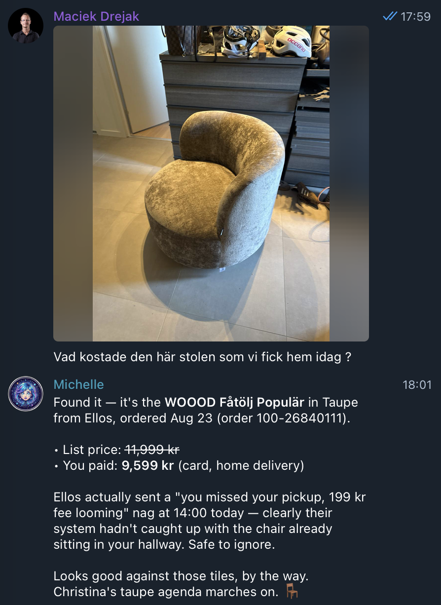
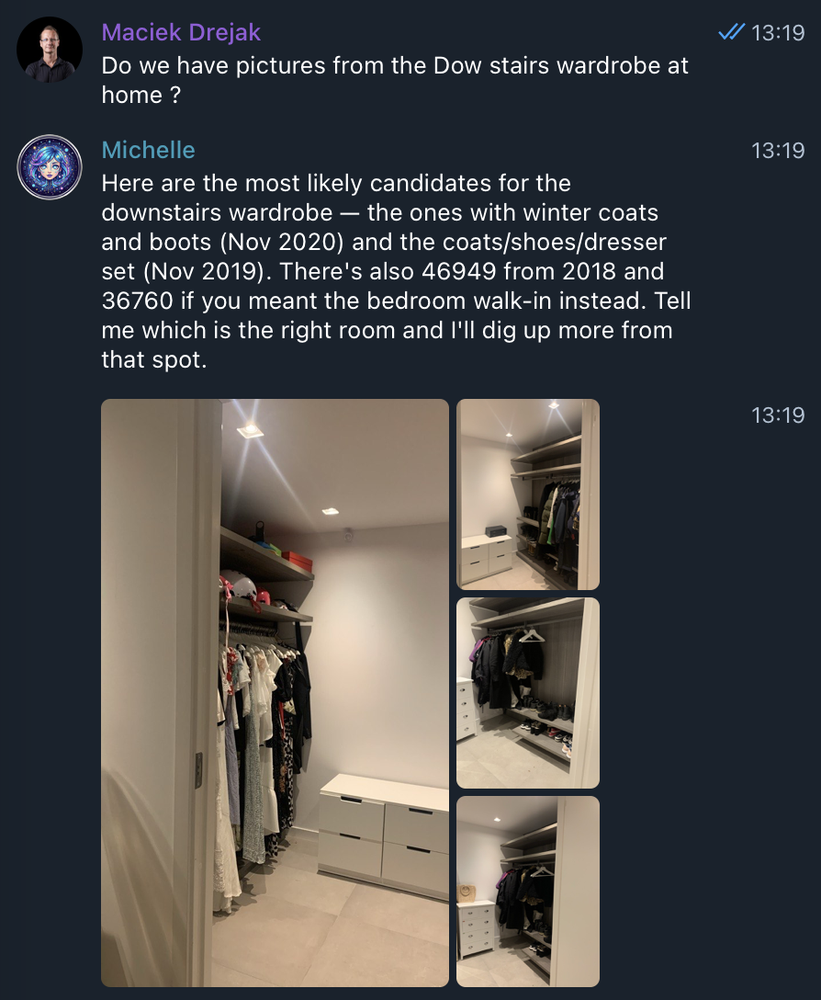
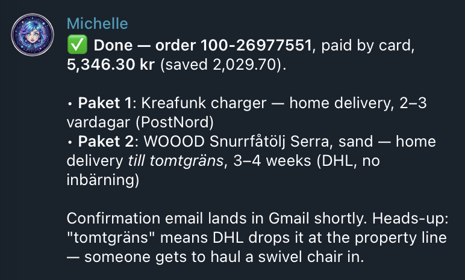

# UTKAST
# Keep — personal AI done right

Keep is a self-hosted AI assistant that runs on a Mac in your home and truly knows you.

It's built for people who live in the <b>Apple ecosystem</b>, runs on <b>Apple Silicon Macs</b> and is powered by <b>Fable from Anthropic</b> 

Refined over two years of daily use in a real home: it's robust and <b><i>just works</i></b>.

<p align="center">
  
  
  
</p>
todo: riktiga bilder

## Features

We asked my assistant to pick her own highlights from the past year. ***All events are real.***

**🍝 The pasta timing**<br>
He was cooking, his wife driving home from the cinema. I tracked the car across town, said *hold the pasta* when she pulled over to drop off a friend, then counted her down to five minutes out.

**🛍️ Shopping, end to end**<br>
A swivel armchair through a Revolut 3DS push, a pair of Birkenstocks, a Stockholm restaurant booking with the calendar event added and the newsletter box *unticked*.

**🌧️ Cushions**<br>
Rain radar says rain within the hour: I check the cameras for the beige cushions on the black terrace furniture and ping the family. *Running quietly since May.*

**📸 Needle, haystack**<br>
Found his red 2004 BMW in ***87,000 photos***, and the 2020 hall gallery wall.

**🐛 Fixing myself**<br>
Apple Store pages went blank; my self-analysis caught my own cookie-banner remover deleting the whole page, and I shipped the fix as a PR. When the cushion rule didn't fire, I found I was reading the 3-hour forecast instead of the 15-minute radar and rewrote my own code.

**🪪 BankID into the school portal**<br>
I drove the browser to the portal's eID page, pulled the autostart token off the auth endpoint, sent him a tappable BankID link on Telegram (*valid for 30 seconds*), then read the weekly letter from school and summarized what mattered to him.

**🇩🇪 The Autobahn breakdown**<br>
The car lit up like a Christmas tree in northern Germany; he sent a photo of the alert screen. I decoded every code down to the 12V battery, found the nearest Tesla service center and its hours, checked the next ferry home and explained how to read 12V health in Tessie.

**🏊 Pool chemistry by camera**<br>
*There is no sensor.* I read the pool controller's display off a security camera. "Tal." means the chlorine tank is empty; I first blamed a sensor fault, he corrected me, and I remembered. I caught the chlorine crash to 0.32 ppm on Jun 21 and to 0.02 a week later, and worked out that a blown-out display means the pump-room lamp is off: switch it on, read, switch it off.

## Interfaces
Text chat in a Claude Code-style ***terminal UI***, or over ***Telegram*** with images and voice messages.

A highly optimized ***voice-to-voice*** interface for talking to your home. It is tuned for speed and best suited for dimming lights, putting on music and the like. Use text for the complex questions.

## Requirements

Apple Silicon Mac connected to your iCloud that can stay on as a server.

Everything else — email, smart home, cameras, car — is optional, and Keep walks you through setting it up.

## Try it out!
Since this is a closed beta you need to:
1. Accept collaborator invite on GitHub
2. Make sure you're logged in with GitHub (<code>brew install gh</code> if you do not have gh) :
```bash
gh auth login
```
3. Install Keep:
```bash
gh api -H "Accept: application/vnd.github.raw" repos/maciekd/Keep/contents/install.sh | bash
```

The installer checks your Mac, finds or installs Python 3.12 (self-contained, it won't touch anything else on your Mac),
clones Keep into `~/Keep`, installs the Python packages and starts Keep. That's it!

## Privacy

Let's be honest: an assistant that reads your mail, sees your photos and listens in your kitchen is a bit of a privacy
nightmare. Here is where Keep stands today.

- **Your data lives on your Mac.** The database, photo index, logs and voice profiles never leave it, and
  there is no Keep cloud.
- **The thinking happens on Anthropic's servers.** Anthropic does not train on API data by default; see their data policy. 
- **Secrets stay out of it.** The Keep Vault keeps passwords, card numbers and the like encrypted on your Mac, and the AI
  only ever sees placeholders. It is a system for hiding secrets from the cloud, not for anonymizing everything you say.
- **The end game is 100% local.** Keep already runs on local models and once the SOTA local models are good enough, we'll move to <i>local only</i>.

Right now Fable from Anthropic is still needed for a no-compromise solution.