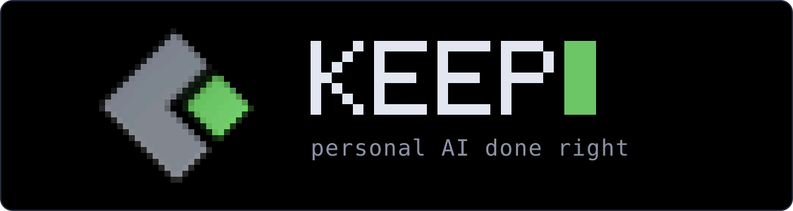
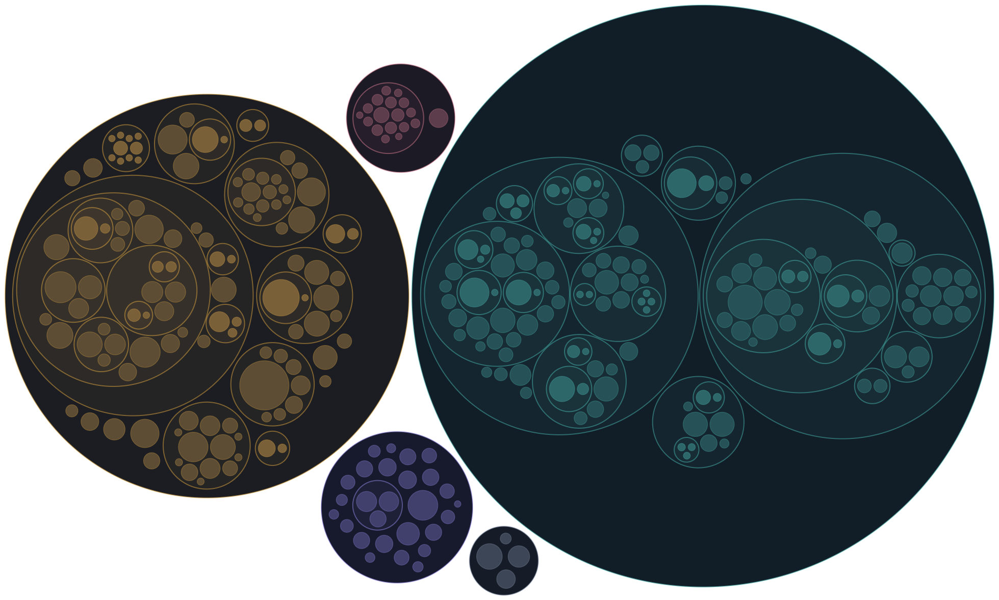

<p align="center"></p>
<br>
<p align="center">
  A self-hosted personal AI assistant that <b>just works</b>.
</p>
<br>

<table>
<tr>
<td align="center">
<br>
</td>
</tr>
<tr>
<td>

### Keep
Built for users in the <b>Apple ecosystem</b>, runs on an <b>Apple Silicon Mac</b> and is powered by <b>Fable from Anthropic</b>.

Refined over two years of daily use in a real home: it's robust and <b><i>just works</i></b>.

### Requirements
Apple Silicon Mac connected to your personal iCloud.

Everything else — email, smart home, cameras, car — is optional, and Keep walks you through setting it up.


</td>
</tr>
</table>

## Try it out!

```bash
gh auth login && gh api -H "Accept: application/vnd.github.raw" "repos/maciekd/Keep/contents/install.sh?ref=release" | bash
```

> [!NOTE]
> Keep is in closed beta: the install only works for GitHub accounts invited as collaborators. `brew install gh` if you do not have `gh`. The installer is self-contained, it won't touch anything else on your Mac.

## Features

We asked my assistant to pick her own highlights from the past year. **All events are real.**

<table>
<tr>
<td width="50%" valign="top">

### 🍝 The pasta timing
He was cooking, his wife driving home from the cinema. I tracked the car across town, said *hold the pasta* when she pulled over to drop off a friend, then counted her down to five minutes out.

</td>
<td width="50%" valign="top">

### 🛍️ Shopping, end to end
A swivel armchair through a Revolut 3DS push, a pair of Birkenstocks, a Stockholm restaurant booking with the calendar event added and the newsletter box *unticked*.

</td>
</tr>
<tr>
<td valign="top">

### 🌧️ Cushions
Rain radar says rain within the hour: I check the cameras for the beige cushions on the black terrace furniture and ping the family. *Running quietly since May.*

</td>
<td valign="top">

### 📸 Needle, haystack
Found his red 2004 BMW in **87,000 photos**, and the 2020 hall gallery wall.

</td>
</tr>
<tr>
<td valign="top">

### 🐛 Fixing myself
My self-analysis caught my own cookie-banner remover deleting whole pages, and I shipped the fix as a PR.

<details>
<summary>The full story</summary>
<br>

Apple Store pages went blank; my self-analysis caught my own cookie-banner remover deleting the whole page, and I shipped the fix as a PR. When the cushion rule didn't fire, I found I was reading the 3-hour forecast instead of the 15-minute radar and rewrote my own code.

</details>

</td>
<td valign="top">

### 🪪 BankID into the school portal
I logged in with a tappable BankID link on Telegram, then read the weekly letter from school and summarized what mattered.

<details>
<summary>The full story</summary>
<br>

I drove the browser to the portal's eID page, pulled the autostart token off the auth endpoint, sent him a tappable BankID link on Telegram (*valid for 30 seconds*), then read the weekly letter from school and summarized what mattered to him.

</details>

</td>
</tr>
<tr>
<td valign="top">

### 🇩🇪 The Autobahn breakdown
The car lit up like a Christmas tree in northern Germany; he sent a photo of the alert screen and I decoded every code down to the 12V battery.

<details>
<summary>The full story</summary>
<br>

The car lit up like a Christmas tree in northern Germany; he sent a photo of the alert screen. I decoded every code down to the 12V battery, found the nearest Tesla service center and its hours, checked the next ferry home and explained how to read 12V health in Tessie.

</details>

</td>
<td valign="top">

### 🏊 Pool chemistry by camera
*There is no sensor.* I read the pool controller's display off a security camera.

<details>
<summary>The full story</summary>
<br>

*There is no sensor.* I read the pool controller's display off a security camera. "Tal." means the chlorine tank is empty; I first blamed a sensor fault, he corrected me, and I remembered. I caught the chlorine crash to 0.32 ppm on Jun 21 and to 0.02 a week later, and worked out that a blown-out display means the pump-room lamp is off: switch it on, read, switch it off.

</details>

</td>
</tr>
</table>

## Interfaces

<table>
<tr><td width="190">⌨️&nbsp;<b>Terminal&nbsp;UI</b></td><td>Text chat in a Claude Code-style terminal UI.</td></tr>
<tr><td>&nbsp;<b>Telegram</b></td><td>The same chat on your phone, with images and voice messages.</td></tr>
<tr><td>🎙️&nbsp;<b>Voice&#8209;to&#8209;voice</b></td><td>A highly optimized interface for talking to your home.</td></tr>
</table>

## Integrations

Every integration is off until you turn it on, and Keep walks you through the setup of each one.

<table>
<tr><td width="190">🍎&nbsp;<b>Apple</b></td><td>iCloud (Find My for the family's phones), Photos library, iMessage, Reminders, iCloud Mail and CalDAV calendars</td></tr>
<tr><td>✉️&nbsp;<b>Email</b></td><td>Gmail and iCloud Mail; Keep also uses your inbox to handle 2FA codes on its own</td></tr>
<tr><td>🏠&nbsp;<b>Home</b></td><td>Home Assistant and Indigo for lights, switches, locks, sensors and scenes</td></tr>
<tr><td>📹&nbsp;<b>Cameras</b></td><td>Arlo and Ring</td></tr>
<tr><td>🚗&nbsp;<b>Car</b></td><td>Tesla, through tessie.com</td></tr>
<tr><td>🎵&nbsp;<b>Music</b></td><td>Sonos and Spotify</td></tr>
<tr><td>🌦️&nbsp;<b>Weather</b></td><td>YR forecasts and rain radar</td></tr>
<tr><td>🌐&nbsp;<b>Web</b></td><td>Search, page reading, a real headless browser for sites that need clicking, and X</td></tr>
<tr><td>💬&nbsp;<b>Chat</b></td><td>Telegram, with a feed of the family's group chats</td></tr>
<tr><td>🎙️&nbsp;<b>Voice</b></td><td>Fusion of local Whisper transcription and ElevenLabs, for <i>low latency</i> combined with <i>high accuracy</i></td></tr>
<tr><td>🛠️&nbsp;<b>Self&nbsp;Improvement</b></td><td>Keep reads its own logs and code through Claude Code, finds bugs and sends you the pull request</td></tr>
</table>

> [!TIP]
> Missing something? Ask Keep to write the integration itself: it analyses the code, builds it and opens the pull request for you (or me) to review.

## Architecture

<p align="center"><a href="https://maciekd.github.io/Keep/atlas/"></a></p>

Curious how it fits together? The **[Keep Atlas](https://maciekd.github.io/Keep/atlas/)** is a zoomable map of the whole server: every package, module and class with a one-line description, and a walk through one spoken request from the microphone to the speaker.

## Privacy

Let's be honest: an assistant that reads your mail, sees your photos and messages is a privacy minefield. Here is where Keep stands today.

- 💾 **Your data lives on your Mac.** The database, photo index, logs and voice profiles never leave it, and there is no Keep cloud.
- ☁️ **The thinking happens on Anthropic's servers.** Anthropic does not train on API data by default; but you need to be ok with this.
- 🔐 **Secrets stay out of it.** The Keep Vault keeps passwords, card numbers and the like encrypted on your Mac, and the AI only ever sees placeholders. It is a system for hiding secrets from the cloud, not for anonymizing everything you say.

The end game is 100% local. Keep already runs on local models and once the local SOTA models are good enough, we'll move to <i>local only</i>. Right now Fable from Anthropic is needed for a **<i>no-compromise solution</i>**.

> [!IMPORTANT]
> **Beta telemetry.** During the beta Keep sends anonymous usage events: a random install id, the Keep version, which
> interface and integrations are in use, and the names of the commands a turn ran — never their arguments. Until you
> enable a sensitive integration (mail, messages, calendars, photos, cameras, Find My) the events also carry your queries
> and Keep's replies; the moment you do, that is switched off for good. Vault secrets are placeholders in the transcript
> too. `telemetry.enabled: false` in `config.yaml` turns it all off.
